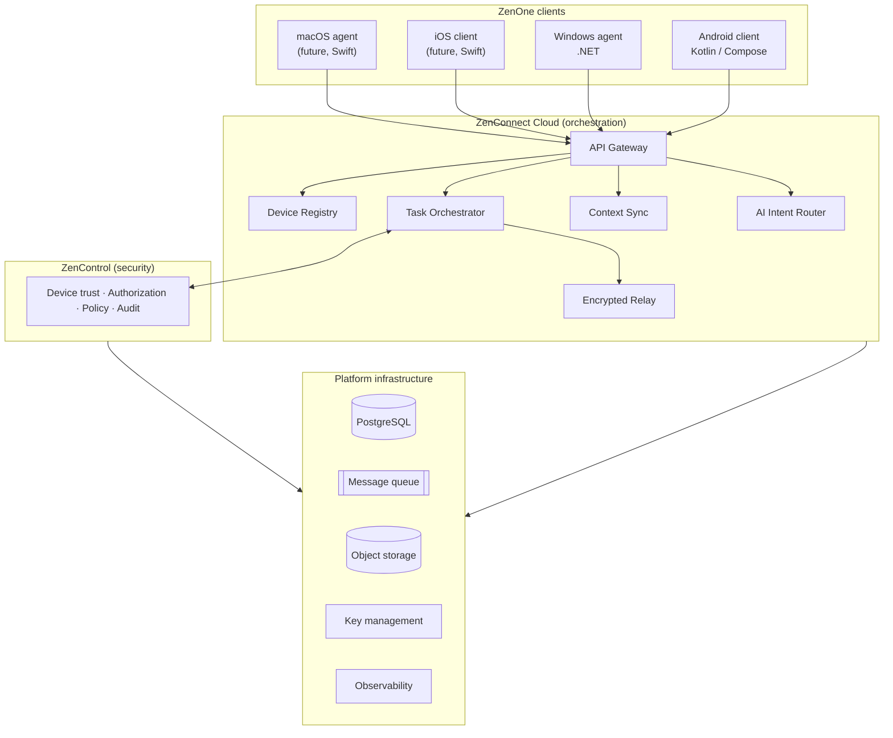

# ZenOne — Overview

**Doc ID:** ZENONE-OVR-001 · **Version:** 0.0.2 · **Status:** Prototype scaffolding in progress

## Vision

**One AI. Every Device. One Digital Life.**

**Mission:** Eliminate friction between devices, applications and operating systems through secure conversational AI.

**Fundamental principle:** one user identity, multiple trusted devices, shared AI context, and secure cross-device task execution.

ZenOne treats all of a user's enrolled devices as one AI-managed computing environment, independent of any single device ecosystem (e.g. Android phone + Windows laptop, iPhone + Windows, Android + MacBook).

## Product stack

| Layer | Responsibility |
|---|---|
| ZenOne client | Conversational UI, local capabilities (approved folders, file picker, local executor, secure key storage) |
| ZenConnect | Registration, presence, task routing, encrypted delivery, transfer coordination, task lifecycle, conversation sync, AI intent orchestration |
| ZenControl | Device identity, user consent, permission grants, policy decisions, action approval, audit, revocation enforcement |

## Platforms

| Platform | Status |
|---|---|
| Android | MVP (launch) |
| Windows | MVP (launch) |
| iOS | Designed in; after MVP exit decision |
| macOS | Designed in; after MVP exit decision |

## Boundaries

- ZenOne does **not** automatically gain access to all apps or local files on registration.
- Every device must be enrolled, every capability supported, and every action within explicit authorization scopes.
- Excluded initially: arbitrary shell commands, unrestricted app automation, banking transactions, purchases, privileged device administration.
- The language model never directly invokes unrestricted system commands; it only proposes structured actions.

## Success definition

A user can start a task on one device, have another trusted device perform an authorized operation, and receive the verified result — without manually transferring information or repeating context.

**North star:** weekly users completing at least one verified cross-device task.
