# ZenOne — MVP Specification

**Doc ID:** ZENONE-MVP-001 · **Version:** 0.1 Private Beta (source) / pack 0.0.1 · **Status:** Proposed 12-week build

| Field | Value |
|---|---|
| Release | 0.1 Private Beta |
| Initial platforms | Android and Windows |
| Proposed duration | 12 weeks |
| Target | 20–50 private beta users |

**Central hypothesis:** Will people regularly use a personal AI to move information and execute tasks across devices that belong to different ecosystems?

## 1. MVP objective

Demonstrate reliable, secure communication and task execution between an Android phone and a Windows laptop through one ZenOne account.

The MVP must prove:

1. Device-independent identity
2. Secure device-to-device communication
3. File discovery and transfer
4. Shared conversational context
5. Authorized remote command execution
6. Verified task completion

## 2. MVP features

| ID | Feature | Scope | Acceptance |
|---|---|---|---|
| MVP-01 | User registration | Email registration and verification; secure authentication; account recovery; device enrollment; active-session management | A user can sign in to the same account from Android and Windows and see both enrolled devices. |
| MVP-02 | Device management | Registered device directory; device names and OS; online/offline status; device capability manifest; device removal and access revocation | Revoking a device prevents subsequent authorized task execution from that device. |
| MVP-03 | Cross-device file sharing | Select a file on one device; send to another registered device; encrypted transfer; progress; integrity verification; completion notification | Destination file matches source checksum; a failed transfer is never marked successful. |
| MVP-04 | AI file discovery | e.g. "Find the latest quarterly report on my laptop." Search approved folders; filter by filename and metadata; resolve ambiguous matches; return source device and file details | Search does not expose files outside explicitly approved locations. |
| MVP-05 | Conversational commands | Find file; transfer file; open file on desktop; summarize selected document; list connected devices; check task status | Commands resolve into validated, typed actions. Unsupported requests get an explanation, not an unsafe attempted execution. |
| MVP-06 | Shared AI conversations | Shared chat history; synchronized task status; cross-device continuation; user-controlled deletion | Users can resume an authorized conversation from either device without duplicating executed tasks. |
| MVP-07 | Security and permissions | Device identity and pairing; folder-level access permissions; capability-level authorization; human confirmation for sensitive operations; audit records; revocation and expiry | All execution paths enforce authorization before action. |

## 3. Excluded from initial MVP

- iOS and macOS applications
- Third-party consumer booking APIs
- WhatsApp personal account automation
- Banking or payment execution
- Arbitrary remote shell commands
- Unrestricted screen or accessibility control
- Enterprise team collaboration
- Public agent marketplace

## 4. Development roadmap (12 weeks)

| Phase | Timeline | Deliverable |
|---|---|---|
| Foundation | Weeks 1–2 | Architecture, identity, CI/CD |
| Device connectivity | Weeks 3–4 | Android/Windows pairing and trust |
| Secure communication | Weeks 5–6 | Task messaging and file transfer |
| AI commands | Weeks 7–8 | Intent parsing, file discovery, approvals |
| Context and UX | Weeks 9–10 | Chat synchronization, summarization |
| Hardening | Weeks 11–12 | Security testing, private beta |

```mermaid
gantt
  title ZenOne MVP — 12 weeks
  dateFormat  X
  axisFormat  W%s
  section Build
  Foundation            :0, 2
  Device connectivity   :2, 4
  Secure communication  :4, 6
  AI commands           :6, 8
  Context and UX        :8, 10
  Hardening + beta      :10, 12
```

## 5. Release acceptance criteria

*Proposed targets to validate, not achieved results.*

| Criterion | Target |
|---|---|
| Supported workflows succeed in controlled pilot testing | ≥ 95% |
| File transfers succeed on stable test networks | ≥ 99% |
| Checksum validation for completed transfers | 100% |
| Known critical/high-severity vulnerabilities at release | 0 |
| Execution after effective permission revocation | None |
| Offline devices and expired tasks | Handled correctly |
| Approval and execution-status experience | Clear |

## 6. Suggested engineering team

- Product owner / product designer
- Android engineer
- Windows engineer
- Backend/platform engineers (2)
- AI engineer
- Shared QA and security engineering

## 7. MVP exit decision

Proceed to macOS and iOS expansion if the private beta demonstrates reliable cross-device execution, repeated user engagement, and meaningful time savings. Otherwise, refine the core workflows before expanding platform coverage.
