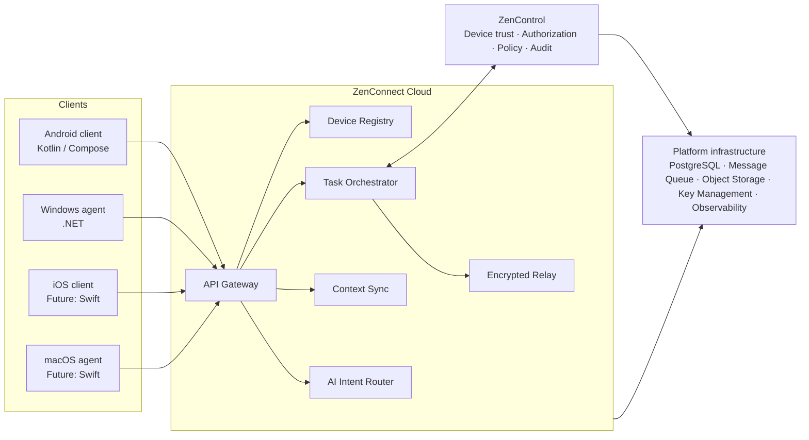
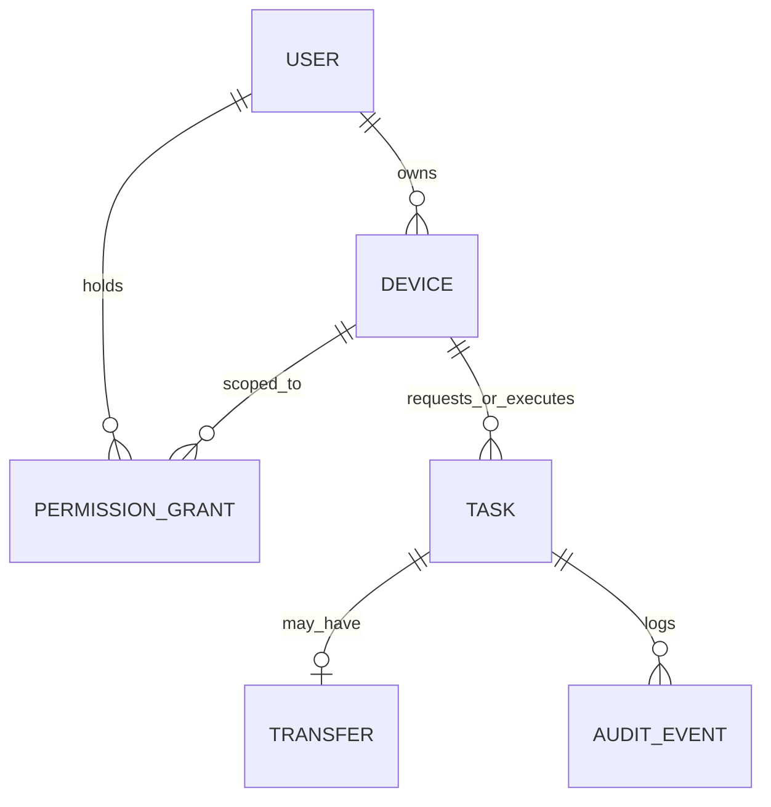
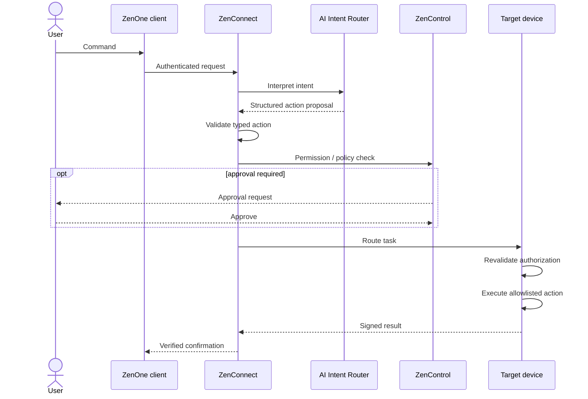
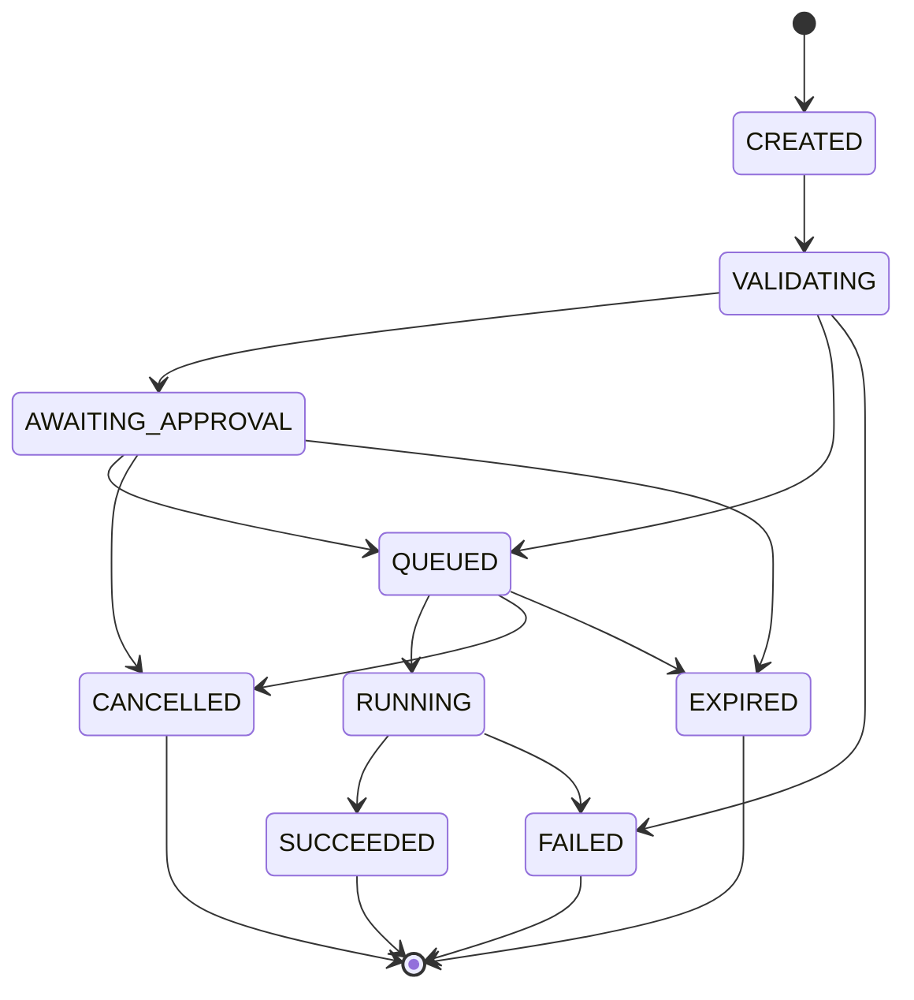

# ZenOne — Technical Design Document

**Doc ID:** ZENONE-TDD-001 · **Architecture version:** 1.0 (source) / pack 0.0.1 · **Status:** Reference architecture (proposed)

| Field | Value |
|---|---|
| Initial target | Android + Windows |
| Future targets | iOS, macOS (designed in from the outset) |
| Design principles | Secure by default, platform-independent, modular, observable, extensible |

> Note: stack choices in §2 are the source's *proposals*. Auth and backend are **open decisions** — see [04-decisions.md](04-decisions.md).

## 0. Reference architecture

## 1. Technical architecture

ZenOne consists of three logical layers.

### A. ZenOne client layer

Provides the conversational interface and local device capabilities.

| Platform | Components |
|---|---|
| Android | Kotlin; Jetpack Compose; Android Keystore; foreground/background work within OS restrictions; file picker and user-approved content access |
| Windows | .NET desktop agent; system tray interface; approved-folder indexing; local task executor; secure device credential storage |
| macOS (future) | Swift |
| iOS (future) | Swift, App Intents, supported share/file interfaces |

### B. ZenConnect orchestration layer

Responsible for: device registration · presence tracking · task routing · encrypted message delivery · file-transfer coordination · task lifecycle management · conversation synchronization · AI intent orchestration.

### C. ZenControl security layer

Responsible for: device identity · user consent · permission grants · policy decisions · action approval · audit records · revocation enforcement.

## 2. Recommended technology stack (proposed)

| Layer | Proposed technology |
|---|---|
| Android | Kotlin / Jetpack Compose |
| Windows | .NET 8+ |
| macOS / iOS | Swift |
| Backend | TypeScript / NestJS *(open — see ADR-002)* |
| API | REST + WebSocket |
| Database | PostgreSQL |
| Message transport | Durable queue + WebSocket |
| Cache / presence | Redis |
| File relay | Encrypted object storage |
| Authentication | OIDC / Passkeys *(open — see ADR-001)* |
| AI orchestration | Provider-agnostic model adapter |
| Observability | OpenTelemetry |
| Infrastructure | Containerized cloud deployment |
| Secrets | Managed secrets and key service |

Technology selections are proposed and should be confirmed through architecture review.

## 3. Core services

| Service | Responsibility |
|---|---|
| Identity Service | Accounts, authentication sessions, recovery, device enrollment |
| Device Registry | Registered devices, public keys, capabilities, platform info, last-seen status |
| Task Orchestrator | Receives commands, determines execution targets, validates policy decisions, manages task states |
| AI Intent Router | Converts natural-language requests into structured action proposals. **The model must never directly invoke unrestricted system commands.** |
| Device Executor | Runs allowlisted actions on the authorized target device |
| File Transfer Service | Negotiates encrypted transfers and verifies completion |
| Context Synchronization Service | Syncs user-authorized conversations, task metadata, selected context |
| Audit Service | Records policy decisions, command execution events, verified outcomes |

## 4. Data model

| Entity | Fields |
|---|---|
| User | user_id, identity_subject, verified_email, created_at, account_status |
| Device | device_id, user_id, platform, device_name, public_key, capabilities, last_seen, trust_status |
| PermissionGrant | grant_id, user_id, device_id, capability, resource_scope, expires_at, revoked_at |
| Task | task_id, requester_device_id, executor_device_id, action_type, payload_reference, idempotency_key, status, created_at, expires_at |
| Transfer | transfer_id, task_id, source_device_id, destination_device_id, file_digest, byte_count, status |
| AuditEvent | event_id, task_id, actor_id, policy_decision, timestamp, outcome |

## 5. Command execution lifecycle

1. User submits a command.
2. ZenOne authenticates the request.
3. AI interprets the intent.
4. ZenConnect validates the structured action.
5. ZenControl checks permissions and policies.
6. User approval is requested when required.
7. ZenConnect routes the task.
8. Target device revalidates authorization.
9. Device executor performs the action.
10. Executor returns a signed result.
11. ZenConnect updates task state.
12. User receives verified confirmation.

**Task states:** `CREATED`, `VALIDATING`, `AWAITING_APPROVAL`, `QUEUED`, `RUNNING`, `SUCCEEDED`, `FAILED`, `CANCELLED`, `EXPIRED`.

*(Transition diagram is an illustrative reading of the source state list; the source lists states but not transitions.)*

## 6. Proposed APIs

| Group | Endpoints |
|---|---|
| Identity and devices | `POST /v1/devices/pair/start`, `POST /v1/devices/pair/confirm`, `GET /v1/devices`, `DELETE /v1/devices/{device_id}` |
| Tasks | `POST /v1/tasks`, `GET /v1/tasks/{task_id}`, `POST /v1/tasks/{task_id}/approve`, `POST /v1/tasks/{task_id}/cancel` |
| Files | `POST /v1/transfers`, `GET /v1/transfers/{transfer_id}` |
| Governance | `GET /v1/permissions`, `POST /v1/permissions`, `DELETE /v1/permissions/{grant_id}`, `GET /v1/audit` |

All endpoints require authentication and appropriate authorization. Request/response sketches: [06-api-sketch.md](06-api-sketch.md).

## 7. Security architecture

| Area | Design |
|---|---|
| Identity | OIDC-compatible authentication with passkey support and short-lived sessions *(auth choice open — ADR-001)* |
| Device enrollment | Per-device asymmetric keys; trust established via an expiring pairing challenge and explicit user approval |
| Encryption | TLS 1.3 for transport; established authenticated-encryption libraries for file payloads; private keys remain on enrolled devices |
| Authorization | Least privilege with capability-level and resource-level grants; checked **before routing** and **immediately before execution** |
| Prompt-injection protection | Documents, filenames, external messages and tool responses are untrusted inputs; model plans cannot override policy or add unauthorized actions |
| Execution restrictions | Allowlisted, typed operations — no arbitrary shell |
| Data protection | Minimize central content, encrypt sensitive data, retention limits, user-controlled deletion |

Details: [07-security.md](07-security.md).

## 8. Offline and failure handling

### 8.1 Offline destination device (source)

If the destination device is offline:

- Queue eligible tasks with expiration
- Show the user a pending state
- Recheck authorization before execution
- Allow cancellation
- Expire tasks that exceed their deadline

### 8.2 Transfers

> The source share ends at the heading "Transfers". Everything below in §8.2–8.3 is **[PROPOSED — not in source share]**, derived only from requirements stated elsewhere in the PRD/MVP/TDD (checksums, encrypted object storage relay, no false success, idempotency keys, expiry, revocation).

**[PROPOSED — not in source share]**

| Situation | Proposed handling |
|---|---|
| Destination offline at send time | Transfer task enters `QUEUED` with `expires_at`. Encrypted payload may be staged in encrypted object storage (File relay) until delivery or expiry; staged payload deleted on expiry/cancel. |
| Source goes offline mid-upload | Transfer stays non-terminal; resumes when source reconnects if before expiry; otherwise `EXPIRED`. Never reported as succeeded. |
| Interrupted download | Destination resumes or retries the download (safe, idempotent operation keyed by `idempotency_key`). |
| Checksum mismatch | Destination discards the file, transfer marked `FAILED` (or retried a bounded number of times). A mismatched file is never surfaced as complete — MVP-03 acceptance. |
| Permission revoked / device revoked during transfer | Authorization rechecked before each execution step; transfer cancelled, staged payload deleted, audit event recorded. |
| User cancels | Transfer → `CANCELLED`; partial data on destination and relay deleted. |
| Success | Only after destination verifies `file_digest` and `byte_count` and returns a signed result does the transfer/task become `SUCCEEDED` and the user get a completion receipt. |

### 8.3 General failure handling

**[PROPOSED — not in source share]**

- **No false success:** a task is `SUCCEEDED` only on a signed executor result (PRD reliability NFR).
- **Retries only for safe operations:** idempotent actions (status, list, find, transfer resume) may retry; non-idempotent actions (e.g. open file) are not blindly retried. Idempotency keys prevent duplicate execution, including when a conversation resumes on another device (MVP-06).
- **Expiry everywhere:** queued and awaiting-approval tasks carry deadlines and move to `EXPIRED`.
- **Unsupported/unsafe requests:** fail early in `VALIDATING` with an explanation (MVP-05).
- **Auditability:** every failure, cancellation, expiry and policy denial produces an AuditEvent.
- **User visibility:** pending, failed and expired states are always shown; the user can cancel any non-terminal task.
