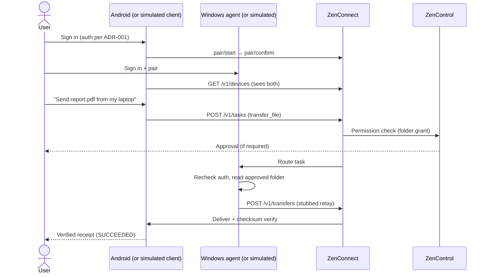

# ZenOne — First Prototype Plan

**Doc ID:** ZENONE-PROTO-001 · **Version:** 0.0.2 · **Status:** In progress — NestJS scaffold complete, critical decisions locked

## Goal

Prove the happy path end-to-end, inside MVP scope: **identity → devices → task → file transfer (stub)**. It is a subset of MVP-01, -02, -03, -05 and -07, not the full 12-week MVP.

## Happy path

## Scope

| Step | Build | Maps to |
|---|---|---|
| 1. Identity | Register/sign-in via chosen auth (or stub behind interface) | FR-01, MVP-01 |
| 2. Devices | Pair two devices (per-device keys, expiring pairing challenge), list, revoke | FR-02/03, MVP-02 |
| 3. Permissions | Folder-level grant for the Windows agent; audit events | FR-09, MVP-07 |
| 4. Task | Create typed `transfer_file` task; lifecycle states; approve/cancel; recheck before execution | FR-10, TDD §5 |
| 5. Transfer stub | Local/in-memory relay; SHA-256 digest + byte count verified; failure never marked success | MVP-03 |
| 6. Status | Task + transfer status endpoints; offline → QUEUED with expiry | TDD §8 |

**Done when:** two enrolled devices on one account; a transfer task completes with matching checksum; revoking the device blocks a subsequent task; every step leaves an audit record.

## Explicit non-goals

- Natural-language/AI intent parsing (typed commands only at first; AI Intent Router later)
- Summarization, voice, shared conversation sync
- Production-grade encryption, KMS, real object storage
- iOS/macOS clients
- Booking APIs, WhatsApp automation, payments, arbitrary shell, unrestricted accessibility control
- Enterprise, marketplace, multi-agent
- Deployment, scale, or performance targets

## Critical decisions status

| # | Decision | Status |
|---|---|---|
| 1 | **Auth model** (ADR-001) | ✅ **LOCKED** — Email + password for prototype (upgradeable) |
| 2 | **Backend stack** (ADR-002) | ✅ **LOCKED** — TypeScript / NestJS |
| 3 | **ZenControl boundary** (ADR-003) | ⏸️ **DEFERRED** — Module inside ZenConnect (revisit during implementation) |
| 4 | **Monorepo layout** | ✅ **IMPLEMENTED** — `packages/zenconnect/` structure |
| 5 | **Prototype clients** | 🔜 **NEXT** — Real Android + Windows apps (or simulated CLI/web clients first) |
| 6 | **Local infra** | 🔜 **NEXT** — In-memory stores for rapid iteration (Postgres/Redis/queue later) |
| 7 | **Approval policy** | 🔜 **NEXT** — Which actions require human confirmation |
| 8 | **AI provider** | 🔜 **LATER** — Model provider + consent rules for private content |
| 9 | **Transfer path** | 🔜 **LATER** — Stub implementation (relay vs. direct) |

## Next steps

With the backend scaffold in place:

1. Implement authentication endpoints (register, login, session management)
2. Implement device pairing flow (start/confirm)
3. Build task creation and routing logic
4. Add permission checking stubs
5. Create transfer coordination stub
6. Develop Android and/or Windows client prototypes OR CLI test clients
