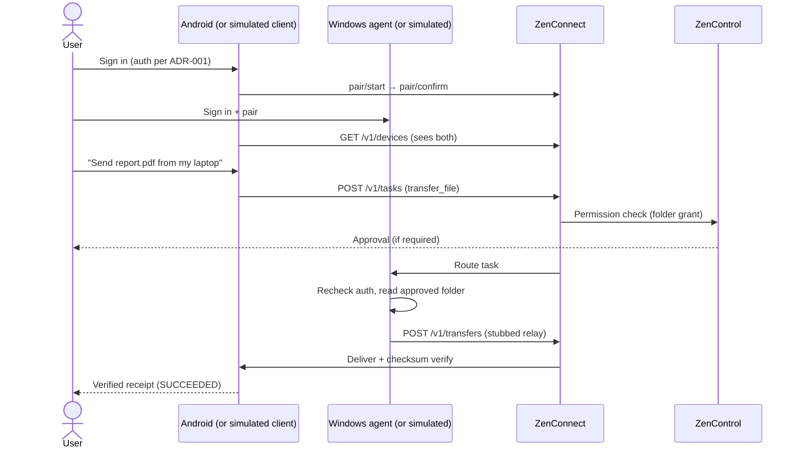

# ZenOne — First Prototype Plan

**Doc ID:** ZENONE-PROTO-001 · **Version:** 0.0.1 · **Status:** Draft — starts only after critical decisions

## Goal

Prove the happy path end-to-end, inside MVP scope: **identity → devices → task → file transfer (stub)**. It is a subset of MVP-01, -02, -03, -05 and -07, not the full 12-week MVP.

## Happy path

## Scope

| Step | Build | Maps to |
|---|---|---|
| 1. Identity | Register/sign-in via chosen auth (or stub behind interface) | FR-01, MVP-01 |
| 2. Devices | Pair two devices (per-device keys, expiring pairing challenge), list, revoke | FR-02/03, MVP-02 |
| 3. Permissions | Folder-level grant for the Windows agent; audit events | FR-09, MVP-07 |
| 4. Task | Create typed `transfer_file` task; lifecycle states; approve/cancel; recheck before execution | FR-10, TDD §5 |
| 5. Transfer stub | Local/in-memory relay; SHA-256 digest + byte count verified; failure never marked success | MVP-03 |
| 6. Status | Task + transfer status endpoints; offline → QUEUED with expiry | TDD §8 |

**Done when:** two enrolled devices on one account; a transfer task completes with matching checksum; revoking the device blocks a subsequent task; every step leaves an audit record.

## Explicit non-goals

- Natural-language/AI intent parsing (typed commands only at first; AI Intent Router later)
- Summarization, voice, shared conversation sync
- Production-grade encryption, KMS, real object storage
- iOS/macOS clients
- Booking APIs, WhatsApp automation, payments, arbitrary shell, unrestricted accessibility control
- Enterprise, marketplace, multi-agent
- Deployment, scale, or performance targets

## Remaining critical decisions

Ask the user before coding:

1. **Auth model** (ADR-001): email OTP / OIDC+passkeys / hybrid / email+password for prototype; hosted IdP vs. self-run.
2. **Backend stack** (ADR-002): NestJS/TS vs. FastAPI vs. Go.
3. **Prototype clients:** real Android + Windows apps, or simulated CLI/web clients first?
4. **ZenControl boundary:** module inside ZenConnect vs. separate service (ADR-003).
5. **Repo:** confirm monorepo layout; when to create private `zenone` repo and push.
6. **Local infra:** docker-compose (Postgres, Redis, queue, object storage emulator) vs. in-memory only.
7. **Approval policy:** which actions require human confirmation in the prototype.
8. **AI provider** (later step): which model provider behind the adapter, and consent rule for sending private content to it.
9. **Transfer path:** relay through encrypted object storage vs. direct device-to-device (prototype uses stub either way).
