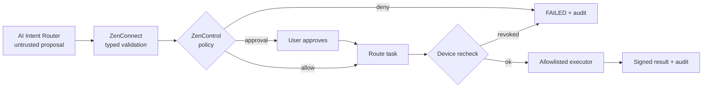

# ZenOne — Security Model

**Doc ID:** ZENONE-SEC-001 · **Version:** 0.0.1 · **Status:** Draft (from ZENONE-TDD-001 §7 and PRD NFRs)

## Principles

- Secure by default, least privilege, explicit consent.
- Registration grants **nothing** automatically: every device enrolled, every capability supported, every action within explicit scopes.
- The AI proposes; policy decides; the device rechecks; the executor signs.

## ZenControl's role

ZenControl is the security layer for ZenOne and ZenConnect.

| Responsibility | What it means |
|---|---|
| Device identity | Tracks trusted devices and their public keys |
| User consent | Records what the user allowed (folders, capabilities, AI content sharing) |
| Permission grants | Capability + resource-scoped grants with expiry and revocation |
| Policy decisions | Allow/deny/require-approval for each structured action |
| Action approval | Human confirmation for sensitive operations |
| Audit records | Policy decisions, execution events, verified outcomes |
| Revocation enforcement | Revoked devices/grants stop execution immediately |

## Controls

| Area | Control |
|---|---|
| Identity | OIDC-compatible auth with passkey support and short-lived sessions (TDD proposal; final choice open — ADR-001) |
| Device enrollment | Per-device asymmetric keys; expiring pairing challenge; explicit user approval |
| Key custody | Private keys stay on enrolled devices (Android Keystore; Windows secure credential storage) |
| Transport | TLS 1.3 |
| Payload encryption | Established authenticated-encryption libraries for file payloads |
| Authorization | Capability-level and resource-level grants; checked **before routing** and **immediately before execution** |
| Prompt injection | Documents, filenames, external messages and tool responses are untrusted; model plans cannot override policy or introduce unauthorized actions |
| Execution | Allowlisted, typed operations only; no arbitrary shell; model never directly invokes system commands |
| Integrity | Checksum validation for every transfer; signed execution receipts; no false completion |
| Data protection | Minimize centrally stored content; encrypt sensitive data; retention limits; user-controlled deletion |
| Privacy | Explicit consent before sending private content to external AI models; configurable retention |
| Audit | AuditEvent for policy decisions, execution, outcomes |

## Out of scope by policy (initial product)

Arbitrary shell commands · unrestricted app automation · unrestricted screen/accessibility control · banking/payments · purchases · privileged device administration.

## MVP security acceptance (proposed targets)

- All execution paths enforce authorization before action (MVP-07).
- No execution after effective permission revocation.
- 100% checksum validation for completed transfers.
- Zero known critical/high-severity vulnerabilities at release.
- Search never exposes files outside approved locations (MVP-04).

## Open security questions

- Auth provider and passkey recovery design (ADR-001).
- Which actions require human approval by default.
- Relay vs. direct transfer; whether relay stores ciphertext only (end-to-end) — proposed in TDD §8.2.
- AI provider data-handling and consent UX.
